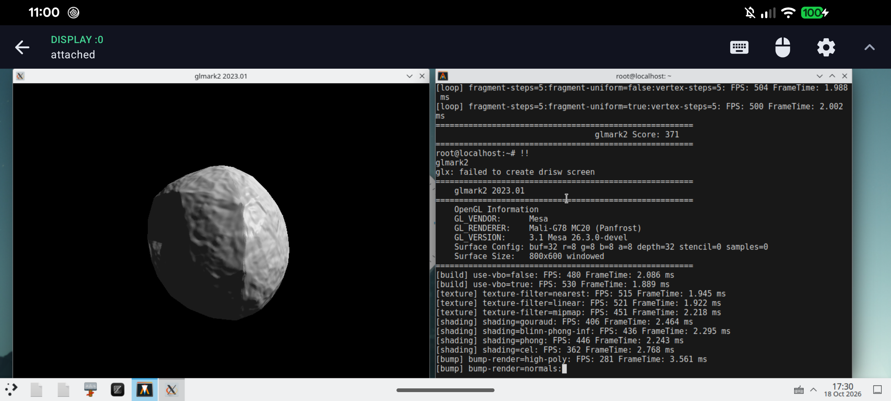

# [Mesa](https://mesa3d.org) - The 3D Graphics Library



<!-- biblioklept -->

## Experimental Android kbase PanVK fork

This fork adds an experimental PanVK backend for proprietary Android `kbase`
drivers, including the Tensor G1 Mali-G78 Job Manager path. It is intended for
arm64 PRoot, chroot, and similar Linux environments which can access
`/dev/mali0`. It is not a universal Mali driver and is not Vulkan-conformant.

## Build and use

### PanVK Vulkan

Start by checking that the Android application domain exposes the GPU node:

```sh
uname -m
ls -lZ /dev/mali0 /dev/dma_heap/system
```

Clone the tested development branch:

```sh
git clone https://github.com/SaicharanKandukuri/tensor-g1-proot-gpu.git
cd tensor-g1-proot-gpu
git switch research/pixel6a-panvk-v9-jm
```

The [PRoot build and run guide](docs/panvk-kbase.md) contains the exact Ubuntu
24.04 dependencies, Meson configuration, package installation, required
mounts, Termux:X11 setup, Zink configuration, troubleshooting, and all
supported runtime switches.

After installing the ICD, the minimum Vulkan environment is:

```sh
export DISPLAY=unix/:0
export VK_DRIVER_FILES=/opt/panvk-kbase/share/vulkan/icd.d/panfrost_icd.aarch64.json
export PAN_I_WANT_A_BROKEN_VULKAN_DRIVER=1
export WSI_X11_TERMUX=1
vulkaninfo --summary
vkcube
```

If the X server does not support the private raw dma-buf transport, use
`PANVK_KBASE_DRI3=0` for the slower MIT-SHM fallback. PRoot cannot bypass
Android permissions or SELinux; seeing a device node does not guarantee that
its ioctls are permitted.

Install the launcher for applications on display `:0`:

```sh
install -Dm755 tools/panvk-run /usr/local/bin/panvk-run
panvk-run vkcube
```

The launcher defaults to the MIT-SHM presentation path. Set
`PANVK_KBASE_DRI3=raw` only with a compatible X server and dma-heap. Packages
using another ICD path can set `PANVK_ICD=/path/to/panfrost_icd.json`.

### Direct Panfrost OpenGL on Tensor G1

The direct Gallium path is a separate experimental driver for the Tensor G1
Mali-G78 Job Manager interface. It does not run OpenGL through Zink or PanVK.
Install the Ubuntu 24.04 build dependencies from the detailed guide above,
then configure the tested GL, EGL, GLES, and GLX build:

```sh
meson setup build-gallium-jm \
  --buildtype=release \
  --prefix=/opt/udroid/panfrost-jm \
  --libdir=lib \
  -Db_ndebug=true \
  -Dbuild-tests=false \
  -Ddisplay-info=disabled \
  -Degl=enabled \
  -Degl-native-platform=surfaceless \
  -Denable-glcpp-tests=false \
  -Dgallium-drivers=panfrost,softpipe \
  -Dgbm=enabled \
  -Dgles1=enabled \
  -Dgles2=enabled \
  -Dglvnd=disabled \
  -Dglx=dri \
  -Dinstall-mesa-clc=false \
  -Dinstall-precomp-compiler=false \
  -Dlibunwind=disabled \
  -Dlmsensors=disabled \
  -Dllvm=enabled \
  -Dmesa-clc=enabled \
  -Dopengl=true \
  -Dpanfrost-kmds=panthor,kbase \
  -Dpanfrost-rust=false \
  -Dplatforms=x11 \
  -Dprecomp-compiler=enabled \
  -Dtools= \
  -Dvalgrind=disabled \
  -Dvideo-codecs= \
  -Dvulkan-drivers= \
  -Dvulkan-layers= \
  -Dxmlconfig=disabled \
  -Dzstd=disabled
meson compile -C build-gallium-jm -j "$(nproc)"
meson install -C build-gallium-jm
```

Use the matching libraries and explicitly opt in to the Kbase JM path:

```sh
export DISPLAY=unix/:0
export PAN_EXPERIMENTAL_KBASE_GL=1
export PAN_KBASE_GL_DRI3=1
export LD_LIBRARY_PATH=/opt/udroid/panfrost-jm/lib:/usr/lib/aarch64-linux-gnu
export LIBGL_DRIVERS_PATH=/opt/udroid/panfrost-jm/lib/dri
export MESA_LOADER_DRIVER_OVERRIDE=panfrost
unset LIBGL_ALWAYS_SOFTWARE GALLIUM_DRIVER
glxinfo -B
glxgears
```

`glxinfo -B` must report `Mali-G78 MC20 (Panfrost)` rather than softpipe or
llvmpipe. `PAN_KBASE_GL_DRI3=1` selects the raw dma-buf GLX bridge for windows
and compositor pixmaps. It requires the matching uDroid/Termux:X11 patches;
without them, leave the variable unset to use the slower X11 image fallback.

### Runtime flags

| Variable | Purpose |
| --- | --- |
| `PAN_EXPERIMENTAL_KBASE_GL=1` | Enable the direct Tensor G1 JM Gallium path. |
| `PAN_KBASE_GL_DRI3=1` | Enable raw dma-buf GLX window presentation and direct compositor-pixmap import with a compatible X server. |
| `PAN_RAW_TFP_TRACE=1` | Trace DRI3 pixmap export/import and texture-from-pixmap contents; diagnostic only. |
| `MESA_LOADER_DRIVER_OVERRIDE` | Use `panfrost` for direct GL or `zink` for OpenGL over PanVK; do not combine the paths. |
| `PAN_MESA_DEBUG=sync` | Wait for every Panfrost job and report faults; use for diagnosis, not performance testing. |
| `VK_DRIVER_FILES=/path.json` | Select only the requested PanVK Vulkan ICD. |
| `PAN_I_WANT_A_BROKEN_VULKAN_DRIVER=1` | Required opt-in for non-conformant PanVK. |
| `WSI_X11_TERMUX=1` | Prefer the Termux:X11 raw dma-buf WSI. |
| `PANVK_KBASE_DRI3=raw` | Explicitly select raw dma-buf presentation. |
| `PANVK_KBASE_DRI3=0` | Force the slower MIT-SHM compatibility path. |
| `PANVK_KBASE_DMA_HEAP=/path` | Override `/dev/dma_heap/system`. |
| `PAN_USE_KRAID=all` | Select KRAID for supported shader stages when the build includes it. |
| `PANVK_DEBUG=kbase_diag` | Enable expensive PanVK Kbase hang diagnostics. |

The detailed guide documents every supported switch, fallback, required mount,
and the global DVFS controls. Internal fault-injection and synchronous-submit
variables are developer probes and should not be added to normal launchers.

Engineering status and validated hardware are tracked in the
[Tensor G1 driver roadmap](docs/tensor-g1-gpu-roadmap.md) and
[research ledger](docs/tensor-g1-gpu-research.md).

## Source

Upstream Mesa lives at <https://gitlab.freedesktop.org/mesa/mesa>. This
experimental fork lives at
<https://github.com/SaicharanKandukuri/tensor-g1-proot-gpu> and its kbase
changes are not supported by the upstream Mesa project.

## Build and install

You can find more information in the
[installation documentation](https://docs.mesa3d.org/install.html), but the
recommended way is to use
[Meson](https://docs.mesa3d.org/meson.html):

```sh
meson setup build
ninja -C build/
sudo ninja -C build/ install
```

## Support

Many Mesa developers use [OFTC's #dri-devel](irc://irc.oftc.net/dri-devel). If
you are not sure which channel is appropriate, ask there and someone will
redirect you. Remember that not everyone is in the same timezone, so it may
take a while before someone qualified sees the question. Check
[Who's Who on IRC](https://dri.freedesktop.org/wiki/WhosWho/) to find who you
are talking to or which nick to ping.

The next best option is the
[mesa-dev mailing list](https://lists.freedesktop.org/mailman/listinfo/mesa-dev).

## Bug reports

If something is not working properly, see the
[Mesa bug-reporting documentation](https://docs.mesa3d.org/bugs.html).

## Contributing

Contributions are welcome. See the
[Mesa contribution documentation](https://docs.mesa3d.org/submittingpatches.html)
for step-by-step instructions. Mesa uses GitLab for patches, review, and
discussion.
